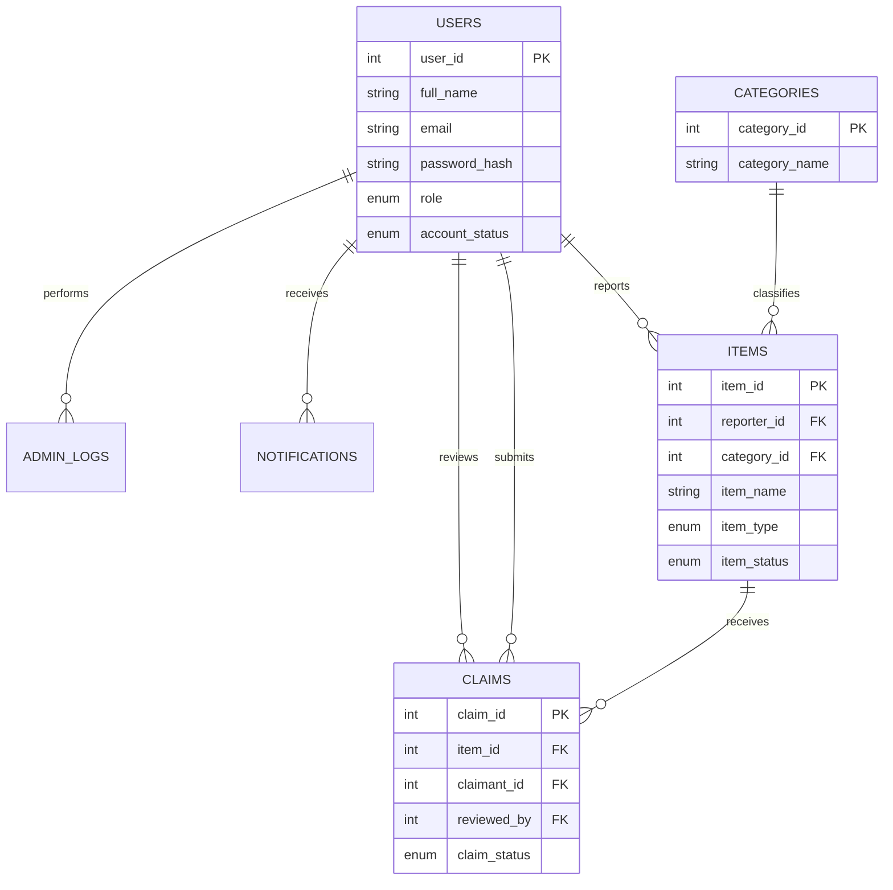

# ER Diagram (text specification)

A user may report many items. A category may classify many items. An item may receive multiple claims. A user may submit multiple claims and an administrator may review many claims.
